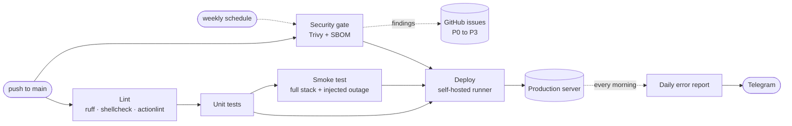

# docker-devsecops-pipeline

[](https://github.com/wenaewu-ai/docker-devsecops-pipeline/actions/workflows/ci.yml)

A complete delivery and operations setup for a Docker Compose application on a single
server: one-push deployment, a security gate that blocks risky releases, verified nightly
database backups, and a daily error report sent to your chat.

The application in this repository is a deliberately tiny notes API (FastAPI, PostgreSQL,
nginx). **The pipeline around it is the product.** It is extracted and generalized from a
setup I built and run in production for an internal business system, with all business
code and data removed.

## What you get

| | What it does | Where |
|---|---|---|
| **One-push deploy** | `lint → test → security → smoke → deploy`. A merge to `main` builds the image, applies database migrations, starts the release and waits for health checks. | [`ci.yml`](.github/workflows/ci.yml) |
| **Security gate** | Trivy scans source and image on every run. High or critical vulnerabilities, leaked secrets, Dockerfile misconfigurations and forbidden licenses stop the deploy. | [`ci.yml`](.github/workflows/ci.yml) |
| **SBOM** | A CycloneDX software bill of materials for the image and the source, attached to every run. | [`ci.yml`](.github/workflows/ci.yml) |
| **Findings become issues** | Each thing to fix gets one GitHub issue with a priority label and upgrade advice. Issues update when severity changes and close themselves when the fix lands. | [`trivy_issues.py`](.github/scripts/trivy_issues.py) |
| **Weekly rescan** | Production's current version is rescanned every week, to catch CVEs published after the last deploy. | [`ci.yml`](.github/workflows/ci.yml) |
| **Smoke test with fault injection** | CI starts the real stack, takes a backup, stops the database on purpose and checks that the error report catches the outage. | [`ci.yml`](.github/workflows/ci.yml) |
| **Verified nightly backups** | `pg_dump` on a schedule; every dump is read back in full before it counts, old dumps are pruned. | [`backup.sh`](backup/backup.sh) |
| **Daily error report** | Every morning: yesterday's errors grouped by cause, marked new or recurring against the past week, plus container health, backup status and traffic. Sent to Telegram. | [`daily_error_report.py`](.github/scripts/daily_error_report.py) |
| **Hardened image** | Non-root user, OS security updates applied at build time, pip removed from the final image. | [`Dockerfile`](Dockerfile) |

## Pipeline



The deploy job runs on the production server itself through a self-hosted runner, so the
server needs no inbound SSH and no deploy credentials are stored on GitHub.

## The daily error report

This is real output (abridged) from the smoke test in this repository, where the database is stopped
on purpose for a few seconds:

```text
📊 [notes-demo] Daily error summary (2026-11-23, UTC)
8 events in 4 groups (🔴 CRITICAL 0 | 🟠 ERROR 8 | 🟡 WARNING 0)
Count | Anomaly
   3x | [ERROR] app: Unhandled error GET /api/notes → psycopg.OperationalError: failed to resolve host 'db'
   3x | [ERROR] nginx: HTTP 500 GET /api/notes
   1x | [ERROR] app: Unhandled error GET /api/notes/{id} → psycopg.OperationalError: failed to resolve host 'db'
   1x | [ERROR] nginx: HTTP 500 GET /api/notes/{id}
🖥 System status
• Containers: nginx ✅ running (restarts 0) | app ✅ running (restarts 0) | backup ✅ running (restarts 0) | migrate ✅ exited (restarts 0) | db ✅ running (restarts 0)
• Database backup: ✅ completed at 14:53
• Traffic (nginx): 6 requests | 4xx 0 | 5xx 4

🟠 #1 [ERROR] app ×3 | 14:53:28 ~ 14:53:28
Unhandled error GET /api/notes → psycopg.OperationalError: failed to resolve host 'db': [Errno -2] Name or service not known
By hour: 14h×3
🆕 First seen in the last 7 days
Location: app/db.py:9 in get_conn
Requests: GET /api/notes×3
```

What makes it useful rather than noisy:

- **Grouping.** Ids, UUIDs, query strings and host names are normalized, so
  `/api/notes/123` and `/api/notes/456` failing for the same reason are one line, not two.
- **Your code, not the framework's.** Each group shows the last stack frame inside the
  application, with the frame that actually raised next to it.
- **New or recurring.** Every group is compared with the previous seven days.
- **Silence is checked too.** A day without a completed backup, a container that is not
  running, an out-of-memory kill and an unexpected restart are all reported. If the report
  itself fails, a one-line notice is sent instead.
- **Deploys do not erase evidence.** Container logs are archived before each deploy, so
  errors from before a release still appear in the next report.
- **Machine-readable.** The full report is also attached as JSON (tracebacks, hourly
  distribution, history), ready for an AI agent or a script to triage.

Each run of the [CI workflow](https://github.com/wenaewu-ai/docker-devsecops-pipeline/actions/workflows/ci.yml)
shows a live report and the Trivy summary on its Summary page.

## Try it locally

Requires Docker with the Compose plugin.

```bash
cp .env.example .env
docker compose up -d --build --wait      # builds, migrates, waits for health checks

curl -X POST localhost:8080/api/notes -H 'content-type: application/json' -d '{"body":"hello"}'
curl localhost:8080/api/notes

# take a verified backup now
docker compose exec backup sh /backup.sh

# break something, then look at the report
docker compose stop db && curl -i localhost:8080/api/notes; docker compose start db
.github/scripts/container_logs.sh collect /tmp/report "$(date -u -d '2 days ago' +%FT00:00:00Z)"
python3 .github/scripts/daily_error_report.py /tmp/report --date "$(date -u +%F)"
```

Run the checks the pipeline runs:

```bash
pip install -r requirements-dev.txt
ruff check . && ruff format --check . && pytest -q
```

## Use it for your own project

1. **Copy the repository** (keep it private, see the security note below) and replace
   `app/` and `migrations/` with your application. Keep the `/healthz` endpoint and the
   catch-all exception handler in `app/main.py`; the health checks and the error report
   rely on them.
2. **Register a self-hosted runner** on your server
   (repository Settings → Actions → Runners). Its work directory becomes the deployment.
3. **Create `.env`** in the runner's checkout directory from `.env.example`. Set a real
   database password and point `BACKUP_HOST_DIR` at a different disk.
4. **Enable deployment**: add the repository variable `DEPLOY_ENABLED` = `true`
   (Settings → Secrets and variables → Actions → Variables).
5. **Enable the daily report**: add the secrets `TELEGRAM_TOKEN` and `TELEGRAM_CHAT_ID`,
   then uncomment the `schedule` block in
   [`daily-error-report.yml`](.github/workflows/daily-error-report.yml).

After that, every merge to `main` that passes the gate is live a few minutes later.

> **Security note.** Do not attach a self-hosted runner to a public repository: anyone who
> can open a pull request could run code on your server. Deployment is switched off in
> this public demo for that reason; use the pipeline from a private repository.

## Operating it

**A scan blocks a release.** Open the run's Summary page: it lists every item to fix with
its priority. Usually the fix is a dependency upgrade (Dependabot opens grouped pull
requests weekly). If a risk has to be accepted for now, add it to
[`.trivyignore`](.trivyignore) with a reason and an expiry date; when the date passes, the
gate blocks again and the decision is made again.

**Production is down and the scan is red.** The repository owner can run the workflow
manually with `force_deploy` and a reason. This skips the security gate only; lint, tests
and the smoke test still have to pass, and the override is recorded in the deploy log.

**Restoring a backup.**

```bash
docker compose exec backup sh -c 'ls -lh /backups'
docker compose exec backup sh -c 'pg_restore --clean --if-exists --dbname="$PGDATABASE" /backups/<file>.dump'
```

## Design decisions

- **Blocking rules follow what you can act on.** Application dependencies block on high and
  critical findings even without an upstream fix, because you can replace a library. Base
  image OS packages block only when a fix exists, because otherwise there is nothing to do
  but wait, and a gate that cannot be satisfied gets switched off.
- **Exceptions expire.** An accepted risk without an end date is a forgotten risk.
- **The emergency exit is narrow and logged.** A gate with no override gets removed the
  first time it blocks an urgent fix. This one keeps tests mandatory, is limited to the
  owner and leaves a trace.
- **Migrations run before the app starts.** The one-shot `migrate` service must succeed
  before the new app container is started, and each migration commits together with its
  bookkeeping row, so a failed run can simply be repeated.
- **A backup is not a backup until it has been read back.** Dumps are written under a
  temporary name and renamed only after `pg_restore` has decoded the whole archive.
- **The liveness check does not touch the database.** A database outage should show up as
  failing requests in the report, not as the app being restarted in a loop.
- **No extra infrastructure.** No log stack, no metrics server, no agent to install: the
  report reads `docker logs` and needs only the Python standard library. This is sized for
  a small team running one or a few servers.

## Repository layout

```text
.github/workflows/ci.yml                  lint, test, security gate, smoke test, deploy
.github/workflows/daily-error-report.yml  the scheduled report job (runs on the server)
.github/scripts/trivy_summary.py          Trivy results → run Summary page
.github/scripts/trivy_issues.py           Trivy results → GitHub issues (open/update/close)
.github/scripts/container_logs.sh         archive logs before a deploy, collect them for the report
.github/scripts/daily_error_report.py     log analysis, grouping, Telegram delivery
backup/backup.sh                          scheduled pg_dump with verification and retention
app/, migrations/                         the demo application and its schema
nginx/nginx.conf, docker-compose.yml      the runtime stack
tests/                                    unit tests, including the CI scripts themselves
```

The CI helper scripts are tested like application code (see [`tests/`](tests)): the rules
that decide whether an issue is opened, updated or closed, and the log parsing, are the
parts most likely to break quietly.

## Adapting it

- **GitLab CI or another runner**: the jobs are plain shell and Docker commands; the
  scripts take files and flags and do not depend on GitHub, except `trivy_issues.py`,
  which calls the `gh` CLI.
- **Slack or email instead of Telegram**: replace `send_message` / `send_document` in
  `daily_error_report.py`; the analysis is separate from delivery.
- **Another database**: replace `backup/backup.sh`, and keep the
  `backup completed` / `backup failed` log prefixes the report looks for. The production
  system this came from uses SQL Server with native `BACKUP ... WITH COPY_ONLY, CHECKSUM`.
- **A managed or external database**: drop the `db` service and pass
  `--services app,nginx,backup` to the report.

## License

[MIT](LICENSE)
